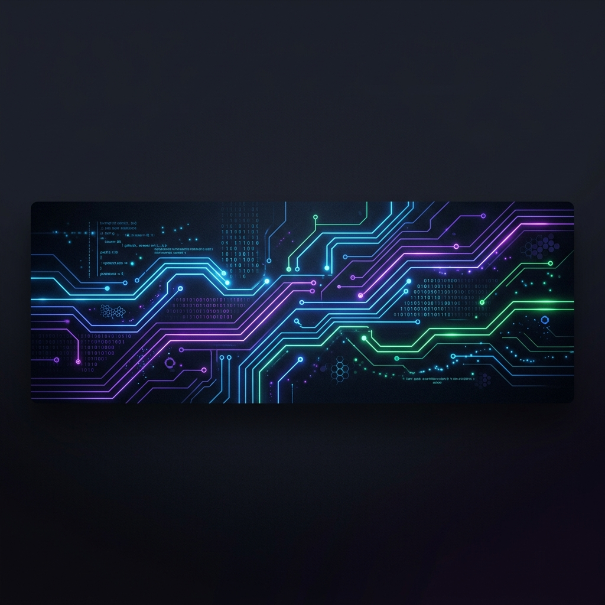

# Huỳnh Duy Nguyên

### Full-Stack Developer · DevOps Enthusiast

I build web applications and explore the tools that make software easier to develop, ship, and maintain.

---

## About

- Focused on full-stack web development and CI/CD automation.
- Exploring Next.js, cloud services, and Kubernetes.
- Interested in collaborating on open-source projects and useful web apps.
- Enjoys building reliable workflows and learning how systems fit together.

## Tech I work with

**Frontend**  

**Backend & databases**  

**Tools & platforms**  

---

## Find me

- GitHub: [@HDNIT3](https://github.com/HDNIT3)
- Email: [nguyenhuynh.663459@gmail.com](mailto:nguyenhuynh.663459@gmail.com)

---

  Thanks for stopping by. Feel free to explore my repositories.

